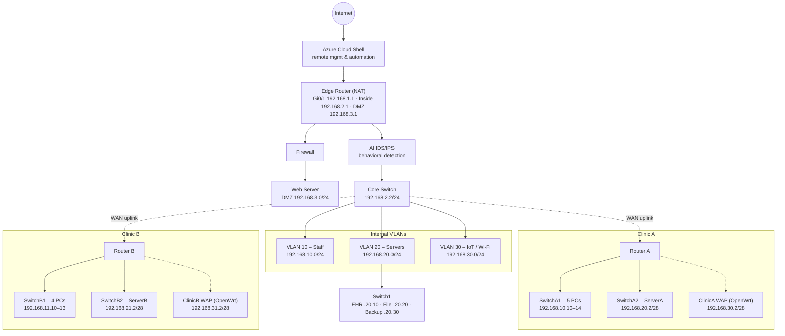
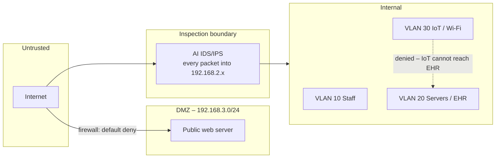
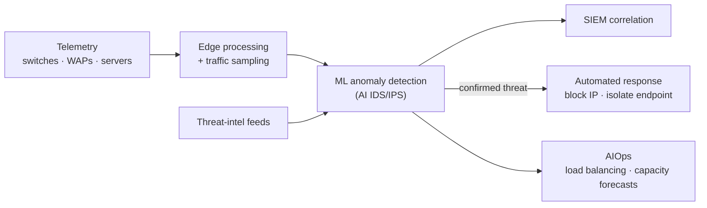
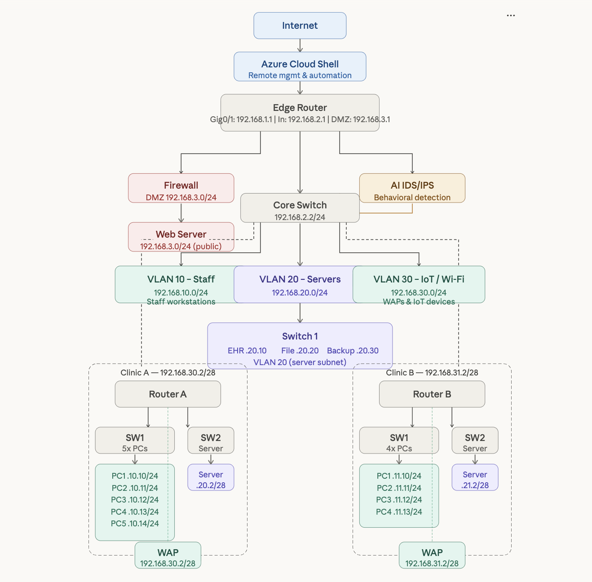

# AI-Enhanced Healthcare Network Design – Pruhart Health

A segmented, multi-clinic healthcare network design with an **AI-driven IDS/IPS**, cloud-based management and AI-assisted operations. It is modeled in **GNS3** and backed by a written architecture and security analysis.

> Built for **WGU E026 – AI for IT Automation and Security** (B.S. Cloud & Network Engineering). The brief: merge two existing network designs for a fictional healthcare provider, *Pruhart Health*, into one converged topology, using generative AI as a design assistant, and evaluate where AI improves automation, performance and security.


---

## Project scope

### Problem
Pruhart Health ran a fragmented network: a main site and two clinics with no consistent segmentation. Patient-data servers, staff PCs and IoT/wireless devices could reach each other, and nothing was monitored centrally. Problems were found after users complained or systems failed.

### Objectives
1. **Converge** two existing diagrams into one standard GNS3 topology, with AI (an LLM) generating the first draft
2. **Segment** the network so a compromise in one zone (DMZ, IoT, a clinic) can't reach electronic health records (EHR)
3. **Add AI security**: behavioral IDS/IPS, threat intelligence feeds and automated incident response
4. **Use AI for operations**: predictive scaling, load balancing across the server VLAN, telemetry-based fault detection
5. **Evaluate** costs, benefits, KPIs and resource overhead of AI-driven automation

### In scope
- Logical and physical topology, IP addressing and VLAN plan
- Security architecture: perimeter, DMZ, IDS/IPS placement, incident response flow
- Scalability, performance (KPIs) and resource-utilization analysis

### Out of scope
- Device-level configuration of the AI/IDS appliances (vendor-specific)
- Procurement and licensing quotes

### Deliverables
| Deliverable | Location |
|-------------|----------|
| GNS3 project (portable export + project file) | [`gns3/`](gns3) |
| AI-generated converged topology | [`images/ai-generated-topology.png`](images/ai-generated-topology.png) |
| AI prompt used | [`images/ai-prompt.png`](images/ai-prompt.png) |
| Written analysis (architecture, scaling, KPIs, security, cost) | [`report/`](report) |

---

## Network architecture



### Security zones



### Addressing plan

| Segment | Subnet | Notes |
|---------|--------|-------|
| Edge – outside | 192.168.1.0/24 | Gi0/1 192.168.1.1 |
| Inside transit | 192.168.2.0/24 | Edge 192.168.2.1, Core Switch 192.168.2.2 |
| DMZ | 192.168.3.0/24 | Public web server behind the firewall |
| VLAN 10 – Staff | 192.168.10.0/24 | Clinic A PCs .10.10–.14 |
| VLAN 20 – Servers | 192.168.20.0/24 | EHR .10, File .20, Backup .30 |
| VLAN 30 – IoT/Wi-Fi | 192.168.30.0/24 | WAPs and IoT devices |
| Clinic B – staff | 192.168.11.0/24 | PCs .11.10–.13 |
| Clinic A/B servers | 192.168.20.0/28, 192.168.21.0/28 | ServerA .20.2, ServerB .21.2 |
| Clinic A/B wireless | 192.168.30.0/28, 192.168.31.0/28 | WAP .30.2, .31.2 |

### GNS3 node inventory
EdgeRouter, Firewall, AI (IDS/IPS), AzureCloudShell, Internet (cloud), CoreSwitch, WebServer, EHRServer, FileServer, BackUpServer, Switch1, RouterA/RouterB (VyOS), SwitchA1/A2, SwitchB1/B2, ServerA/ServerB (Ubuntu 24.04), ClinicAWAP/ClinicBWAP (OpenWrt 23.05).

---

## AI in the design



| Area | Approach | Why it matters here |
|------|----------|---------------------|
| Intrusion detection & prevention | Behavioral ML IDS/IPS at the DMZ-to-internal boundary | Healthcare is a constant ransomware target, and signatures miss new techniques |
| Malware | Signature, heuristic and sandbox layers working together | Each method catches what the others miss |
| Incident response | Auto-block the source IP and quarantine the endpoint within seconds | Stops lateral movement before it reaches the EHR server |
| Scaling | New clinic = router + 2 switches + next subnet block; AI flags capacity limits | Grows without changing the VLAN design |
| Performance | AI routing and load balancing across VLAN 20 at peak EHR hours | Lower latency, higher throughput, better fault tolerance |
| Overhead | Edge processing and traffic sampling | Keeps telemetry bandwidth and CPU cost under control |

**KPIs to measure the result:** a pre-deployment baseline of average latency, packet loss and uptime, compared again 30 days after go-live.

---

## Repository structure

```
.
├── gns3/
│   ├── Pruhart_Health_Network_Diagram.gns3project   # portable export – File > Import portable project
│   ├── Pruhart_Health_Network_Diagram.gns3          # project file
│   └── Pruhart_Health_Topology.json                 # node/appliance summary
├── images/
│   ├── ai-generated-topology.png
│   ├── ai-diagram-chat.png
│   └── ai-prompt.png
└── report/
    └── AI_Network_Automation_and_Security_Report.docx
```

**Opening the lab:** in GNS3 2.2+, choose *File → Import portable project* and pick the `.gns3project`. You will need VyOS, Ubuntu 24.04 cloud image and OpenWrt 23.05 appliances. The disk images aren't included.

## AI-generated diagram



## Lessons learned

- AI was useful for a fast first draft of a merged topology. I still had to check every subnet, link and label against the source diagrams.
- Segmentation sets the blast radius, and AI security only adds value on top of a sound zone design.
- Telemetry needs its own budget for bandwidth, storage and compute. Edge processing and sampling make it affordable across many sites.

---

<sub>Academic project completed at Western Governors University. Pruhart Health is a fictional organization.</sub>
